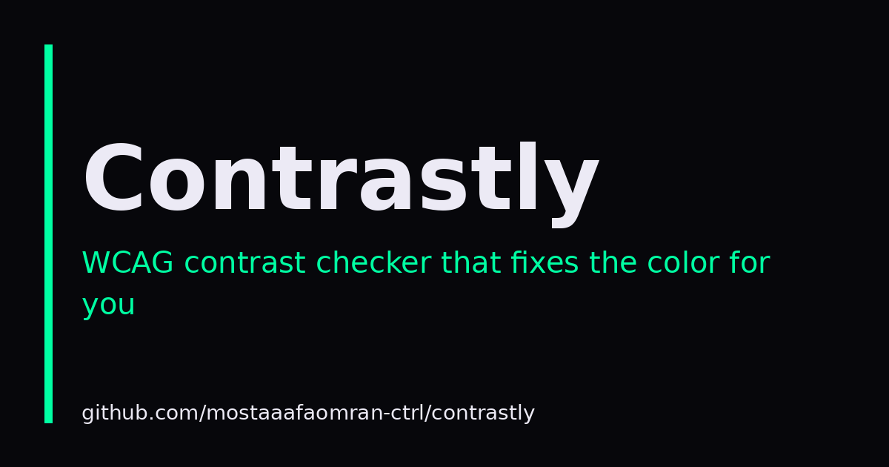

# Contrastly

WCAG contrast checker that fixes the color for you.

 

**Live demo:** https://mostaaafaomran-ctrl.github.io/contrastly/ (add `?demo=1` to see it filled with sample data)

Check text and background contrast against WCAG AA and AAA and get the closest passing color. Offline.

## Features

- AA and AAA for normal text, large text and UI parts
- Live preview with Arabic sample text
- Fix text color or fix background with one click
- Keeps the hue, moves lightness the least
- No dependencies

## Run it locally

It is one `index.html` file. Open it in a browser. No build step, no dependencies, no server.

## Privacy

Everything runs in your browser. Nothing is uploaded. Data you enter is kept in your browser's local storage on your device only.

## بالعربي

افحص تباين الألوان بين النص والخلفية حسب WCAG واحصل على أقرب لون ينجح في الفحص.

افتح الملف `index.html` في المتصفح وهيشتغل على طول، من غير تسجيل ومن غير سيرفر.

## License

MIT
